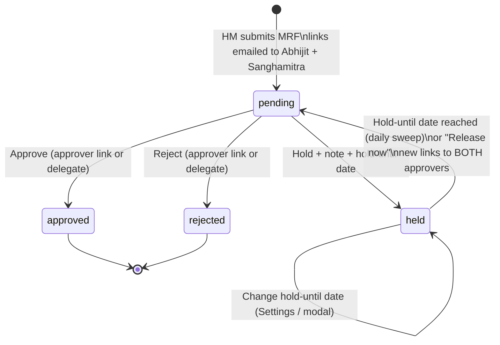

# MRF Hold & Delegate Approval: Implementation Plan

| | |
|---|---|
| **Status** | **Deployed to staging 23 Oct 2026** (PR #105 `pankaj-work-staging-v24` → `project-staging`) and rechecked there (§16). **Prod not done yet** (§16.4). DDL and the 4 email templates (#52–55) applied to the **staging** DB only. Unit 939/939 after the merge; Playwright R1 + H1–H6 run 1 passed (see [PW-Task](PW-Task/README.md)). **Rev 2**: decisions D1–D4 answered; new role **HR Admin Recruiter** (§5A). |
| **Built differently from this plan** | (1) Release time stored as `mrf_hold_release_time` 'HH:MM' IST, not a cron string. (2) The four new notices (On Hold, Hold Date Changed, Decided On Your Behalf, Approvers Away) are **editable DB templates** under Email Templates › General / Alerts (added 22 Oct, rev 3); defaults + send-time fallback in `src/services/mrfHoldEmailTemplates.js`, seeded create-only by `prisma/seed-mrf-hold-email-templates.js`. The approval-request email itself keeps using the existing "MRF Approval Request" template. (3) No `emitToRoles` socket helper: the recruiter emits loop over `RECRUITER_ROOM_ROLES`. (4) The DDL is not added to `pgadmin/01-ddl-all.sql` (a snapshot ending 2026-09-04); it runs with `scripts/run-ddl.mjs`. (5) On release, the request row goes back to `managersubmitted`, its status when it first went for approval. |
| **Date** | 22 Oct 2026 (rev 2 same day) |
| **Branch base** | `pankaj-work-staging-v24` |
| **Builds on** | L04 · MRF Hold ([PLAN-Phase3-in-Phase4.md](../../Phase%203%20Enhancements%20or%20Feedback/PLAN-Phase3-in-Phase4.md#L238)) · B-01 ([02-BUILD-BACKLOG.md](../../UAT-phase3/02-BUILD-BACKLOG.md#L146)) · MRF approval audit trail ([MRF-Approval-Unified-Fix-Plan.md §6](../New%20MRF%20Request%20-%20Approval%20Request/)) |
| **UI mockups** | Design canvas "MRF Hold & Delegate Approval — UI" (link in the hand-over message) |

---

## 1. Goal

**Today**

- Approvers (Abhijit and Sanghamitra) can only **Approve** or **Reject** an MRF, and only through the personal link in their email.
- Nobody can decide from inside the ATS. When both approvers are away, the MRF just waits.

**Change**

1. **Hold**: a third decision at the approval gate. It takes a mandatory **note** and a **hold-until date**.
2. **On the hold-until date**: the MRF goes back to **Pending** and the **same approval email as the first time** is sent again to **both** approvers (Abhijit and Sanghamitra). Their choices are again **Approve / Reject / Hold further**.
3. **Held MRFs are open nowhere**: not on the dashboard as active, not in JD screening, not in the pipeline, and not in vendor role lists.
4. **Hold settings in the UI**: the default and maximum hold length (180 days by default, **changeable in Settings**), plus a **Held MRFs** list where an authorised user can **change the hold-until date** or **release the hold now**. All of this lives in **Settings**.
5. **New role: HR Admin Recruiter.** It sits between Admin and Recruiter (`superadmin > admin > hr_admin_recruiter > recruiter > vendor`). It has every Recruiter permission plus the MRF extras in this plan. **Chhaya Verma is moved to this role.**
6. **Decide on behalf of approvers from the ATS**: **Super Admin, Admin and HR Admin Recruiter** can **Approve / Reject / Hold** from the MRF details screen, **but only while Abhijit and Sanghamitra are marked absent**. There is no override without an absence window. Plain Recruiters cannot do this.

**Done when**

- A held MRF goes back to Pending on its hold-until date, and both approvers get a fresh approval email with working Approve / Reject / Hold buttons.
- Chhaya (HR Admin Recruiter) can decide an MRF from the ATS during an absence window and cannot outside it. A plain Recruiter cannot at all. Every decision is recorded in the approval trail as "on behalf of approvers".
- Chhaya keeps every screen and action she has today as a Recruiter.

---

## 2. How it works today (code facts this plan relies on)

| Area | Where | Fact |
|---|---|---|
| Status column | [schema.prisma:217](../../../backend/prisma/schema.prisma#L217) | `rpa_mrf.approval_status` is a free-text `String`, default `'pending'`. Values in use: `pending`, `waiting` (legacy), `approved`, `rejected`, `completed`, `closed` (legacy). |
| "Still open for a decision" | [reminderEligibility.js:52](../../../backend/src/jobs/reminderEligibility.js#L52) | `OPEN_APPROVAL_STATUSES = {pending, waiting}`. This one set gates deciding, re-issuing links and reminders. |
| Public decision endpoint | [mrf.controller.js:986](../../../backend/src/controllers/mrf.controller.js#L986) | `POST /api/mrf/:id/approve` (public, rate-limited). Rejects any action other than `approve` or `reject` (line 997). |
| Decision core | [mrfApproval.service.js:365](../../../backend/src/services/mrfApproval.service.js#L365) `decide()` | Verifies the personal JWT and resolves the actor from `rpa_mrf_approval_tokens`. It then updates status atomically (`updateMany … where approval_status = <read>`), writes the event, mirrors `rpa_mrf_jd_send.mrfstatus`, revokes the other links (`decided_by_other`) and closes the reminder rows, all in **one transaction**. |
| Issue links | [mrfApproval.service.js:109](../../../backend/src/services/mrfApproval.service.js#L109) `issueApprovalRequests()` | Creates one token per roster approver and sends the personal "New MRF Request - Approval Request" email. Takes a `reason` (`submitted` / `reissued`). |
| Re-issue | [mrfApproval.service.js:643](../../../backend/src/services/mrfApproval.service.js#L643) | HR's "Re-send approval links" (screenshot 4). Revokes the open links and calls `issueApprovalRequests`. |
| Roster | `rpa_settings.mrf_approvers` | JSON `[{email,name,title}]`. Falls back to the `mrfApproval` flow-key recipients. |
| Audit trail | `rpa_mrf_approval_events` | Append-only (a trigger guards it). `chk_mrf_approval_events_type` and `chk_mrf_approval_events_identity` are CHECK lists ([2026-09-25-mrf-approval-audit.sql:75](../../../backend/prisma/ddl/2026-09-25-mrf-approval-audit.sql#L75)). |
| Token revoke reasons | same DDL :40 | CHECK `revoked_reason IN ('decided_by_other','expired','reissued','mrf_closed')`. |
| Reminders | [reminderScheduler.js](../../../backend/src/jobs/reminderScheduler.js) | A daily cron re-sends open `mrf_approval_request` rows every `reminder_interval_days`, up to `reminder_max_count`. |
| Pause columns | schema.prisma:232-235 | `paused_at / paused_reason / paused_by / resume_on` exist for **pausing an approved requisition**. `positionStatus()` already shows `paused_at` as "Paused" ([pipelineAnalytics.helpers.js:266](../../../backend/src/services/pipelineAnalytics.helpers.js#L266)). |
| Roles | [config/roles.js](../../../backend/src/config/roles.js) | `superadmin > admin > recruiter (= legacy hr) > vendor`. **`rpa_users.role` defaults to `recruiter`**, so most internal staff are recruiters. |
| Settings | [settings.controller.js](../../../backend/src/controllers/settings.controller.js), [Settings.jsx](../../../frontend/src/pages/Settings.jsx) | Card-per-feature page (Reminder Settings, Assessment Automation, …), backed by `rpa_settings` key/values. |

---

## 3. Decisions taken in this plan

| # | Decision | Why |
|---|---|---|
| P1 | New `approval_status` value **`held`**. It is **not** in `OPEN_APPROVAL_STATUSES`. | Held must not be decidable through old links or reminded, and must not count as open. Keeping it out of the open set gets all of this from the existing guards. |
| P2 | **Dedicated `hold_*` columns** on `rpa_mrf`, not a reuse of `paused_* / resume_on`. | L04 and B-01 suggested the reuse. However, `paused_at` already drives "Paused" in analytics and the pause-aware JD query, and pause applies to an *approved* MRF. Reusing the columns would mix two lifecycles and make one of them lie in reports. |
| P3 | On the hold-until date the MRF goes to **`pending`** and **every current roster approver** (Abhijit and Sanghamitra) gets a **new personal link**. | This is your requirement ("same like first time"). L04 re-prompted only the approver who held it; this plan supersedes that. |
| P4 | The release is a **separate daily job** (`mrfHoldSweep`), not part of the reminder cron. | The reminder cron walks `rpa_email_log` rows, and a held MRF has none open. A separate job also keeps a release from being skipped by reminder-count limits. |
| P5 | Authority to decide on behalf = **role rank ≥ HR Admin Recruiter** (`hr_admin_recruiter`, `admin`, `superadmin`) **AND** an **active absence window**. **No delegate list.** | Your answer to D2. The new role replaces the named list: who can decide is managed by assigning the role in the Admin Portal. Plain `recruiter` is excluded, which matters because every new user defaults to recruiter. The window turns "in the absence of Abhijit & Sanghamitra" into something the system can check and audit. |
| P6 | Only **Admin / Super Admin** open or close the absence window. HR Admin Recruiters cannot. | Someone who could open their own window would authorise themselves. |
| P7 | A delegate decision goes through the **same transaction** as a link decision (shared `applyDecision()`). | One code path keeps one-decision-per-MRF, the audit write, link revocation and reminder closing identical. |
| P8 | Changing the hold-until date and "Release now" are allowed for **rank ≥ HR Admin Recruiter**, from Settings › Held MRFs and from the MRF details modal. **No absence window is needed** for these, because they don't decide the MRF. | "Hold date should be change/manage from UI settings". |
| P9 | Hold-until date: **min tomorrow, max today + `mrf_hold_max_days`** (default **180**), default today + `mrf_hold_default_days` (default **30**). All dates are **IST**. **No limit on how many times** an MRF is held. | Your answer to D3. |
| P11 | **Hold rules** (default days, max days, release time) are **editable by rank ≥ HR Admin Recruiter** in Settings. Plain Recruiters see them **read-only**. | Your answer to D3: "changed from Settings by whoever should access Settings". Every staff user sees the Settings menu today, so editing is limited to the HR Admin Recruiter level and above. If plain Recruiters should edit too, it is a one-line change. |
| P10 | Hold is only offered on **personal links** (audit flow on). It is hidden when `MRF_APPROVAL_AUDIT_ENABLED=false` and on legacy shared links. | A hold needs a known actor to re-prompt and to show in the trail. |

### Decisions confirmed (22 Oct 2026)

| # | Question | Answer |
|---|---|---|
| D1 | Can anyone decide on behalf **without** an absence window? | **No.** Window only, for every role. |
| D2 | Who can decide from the ATS? | **Super Admin → Admin → HR Admin Recruiter** (new role, §5A). Chhaya moves to HR Admin Recruiter. Plain Recruiters cannot. |
| D3 | Limit on how many times an MRF can be held? | **No limit.** Each hold is at most 180 days, and the 180 can be changed in Settings (P11). |
| D4 | Should the hiring manager / submitter get the "on hold" notice? | **Yes.** |
| D5 | Subject line of the re-sent email after release | Same subject as the first email, plus a "Back from hold" banner inside (plan default, not raised as a question). |

---

## 4. Status lifecycle



What each transition does:

| Transition | Status | Links (tokens) | Reminder rows | Emails |
|---|---|---|---|---|
| pending → held | `held`, `held_at`, `held_until`, `held_by_*`, `hold_note`, `hold_count+1` | All open links revoked, reason **`held`** | Closed (`responded_at = now`) | Hold notice to HR + HM + the other approver. Confirmation to the person who held. |
| held → held (date change) | `held_until` updated | n/a | n/a | "Hold date changed" to HR + the holder |
| held → pending (release) | `pending`, `hold_released_at` set; `held_*` kept as history of the last hold | **New** personal link for every roster approver (`issueApprovalRequests({reason:'hold_released'})`) | New `mrf_approval_request` rows, so normal reminders apply | The same approval email as the first time, plus a "Back from hold" banner |
| pending → approved/rejected by delegate | as today + `decided_via='ats_delegate'` | All open links revoked, reason **`decided_by_delegate`** | Closed | Outcome email (as today). "Decided on your behalf" notice to **both** approvers. Confirmation to the delegate. |

---

## 5. Data model (DDL, staging first)

New file `backend/prisma/ddl/2026-10-xx-mrf-hold-and-delegate.sql` plus a rollback file, and add both to `pgadmin/01-ddl-all.sql`. All statements are idempotent (`IF NOT EXISTS`, drop/re-add constraints).

```sql
-- 1. rpa_mrf: hold state (separate from the pause columns, see plan §3 P2)
ALTER TABLE rpa_mrf
  ADD COLUMN IF NOT EXISTS held_at          TIMESTAMPTZ  NULL,
  ADD COLUMN IF NOT EXISTS held_until       DATE         NULL,
  ADD COLUMN IF NOT EXISTS held_by_email    VARCHAR(255) NULL,
  ADD COLUMN IF NOT EXISTS held_by_name     VARCHAR(255) NULL,
  ADD COLUMN IF NOT EXISTS hold_note        VARCHAR(2000) NULL,
  ADD COLUMN IF NOT EXISTS hold_count       INT          NOT NULL DEFAULT 0,
  ADD COLUMN IF NOT EXISTS hold_released_at TIMESTAMPTZ  NULL,
  ADD COLUMN IF NOT EXISTS decided_via      VARCHAR(20)  NULL;  -- 'email_link' | 'ats_delegate'

COMMENT ON COLUMN rpa_mrf.held_until IS
  'Hold-until date (IST) of an MRF held AT THE APPROVAL GATE. On this date mrfHoldSweep returns it to pending and re-sends approval links. NOT the same as resume_on, which is the advisory date for a PAUSED approved requisition.';

-- The sweep's only query: held rows due today or earlier
CREATE INDEX IF NOT EXISTS idx_rpa_mrf_held_due
  ON rpa_mrf (held_until) WHERE approval_status = 'held';

-- 2. audit event types
ALTER TABLE rpa_mrf_approval_events DROP CONSTRAINT IF EXISTS chk_mrf_approval_events_type;
ALTER TABLE rpa_mrf_approval_events ADD CONSTRAINT chk_mrf_approval_events_type CHECK (event_type IN (
  'request_sent','link_opened','approved','rejected','attempt_after_decision',
  'token_invalid','token_expired','token_revoked_used','other_approvers_notified',
  'decision_confirmation_sent','links_reissued','backfilled',
  -- new
  'held','hold_date_changed','hold_released','hold_notice_sent','delegate_notice_sent'));

-- 3. identity: a logged-in ATS user (the delegate) instead of a personal link
ALTER TABLE rpa_mrf_approval_events DROP CONSTRAINT IF EXISTS chk_mrf_approval_events_identity;
ALTER TABLE rpa_mrf_approval_events ADD CONSTRAINT chk_mrf_approval_events_identity CHECK (identity_source IN (
  'personal_link','legacy_shared_link','system','ats_user'));

-- 4. token revoke reasons
ALTER TABLE rpa_mrf_approval_tokens DROP CONSTRAINT IF EXISTS chk_mrf_approval_tokens_revoked_reason;
ALTER TABLE rpa_mrf_approval_tokens ADD CONSTRAINT chk_mrf_approval_tokens_revoked_reason
  CHECK (revoked_reason IS NULL OR revoked_reason IN
    ('decided_by_other','expired','reissued','mrf_closed','held','decided_by_delegate'));
```

- `schema.prisma`: add the 8 fields to `rpa_mrf`, then run `prisma generate`. On Windows, **stop the dev server and the queue worker first**, or the generate fails with EPERM.
- `prior_status` / `new_status` are `VARCHAR(20)`, so `held` fits.
- Staging and prod share a DB host, so run the DDL on the **staging DB only**, run the full test pass, and then do one prod release.

### Settings keys (`rpa_settings`)

| Key | Type | Default | Edited by |
|---|---|---|---|
| `mrf_hold_default_days` | int | `30` | rank ≥ HR Admin Recruiter |
| `mrf_hold_max_days` | int | `180` | rank ≥ HR Admin Recruiter |
| `mrf_hold_sweep_cron` | cron | `0 9 * * *` (IST) | rank ≥ HR Admin Recruiter |
| `mrf_approver_absence` | JSON `{active,from,to,note,setByUserId,setByName,setAt}` | `{active:false}` | Admin / Super Admin only |

Hold rules are editable by **rank ≥ HR Admin Recruiter** (P11). There is no `mrf_delegate_approvers` key: the role replaces it (P5).

Seed the defaults in `prisma/seed-*.js`. Code must fall back to the defaults when a row is missing, following the `reminder_interval_days` pattern.

Feature flags in `config/index.js` (import it first in scripts, because of the env-precedence issue): `MRF_HOLD_ENABLED`, `MRF_DELEGATE_DECISION_ENABLED`. Both default **false** on prod until sign-off.

---

## 5A. New role: HR Admin Recruiter

### Definition

| | |
|---|---|
| Stored value (`rpa_users.role`) | `hr_admin_recruiter` (lower case, like every other role; `restrictTo` and `normalizeRole` lower-case anyway) |
| Display label | **HR Admin Recruiter** |
| Rank | **25** in `ROLE_RANK` (superadmin 40 › admin 30 › **hr_admin_recruiter 25** › recruiter 20 = hr 20 › vendor 10) |
| Admin tier? | **No.** `isAdminTier()` stays admin/superadmin, so there is no Admin Portal, no user management, no IP/device in the approval trail, and no admin-only config cards. |
| Module toggles | Same as Recruiter: uses `rpa_module_permissions` and does **not** bypass module checks. Chhaya's existing toggles stay, because they are keyed by user id. |
| Assignable by | Admin and Super Admin (add to `ADMIN_ASSIGNABLE_ROLES`). |
| DB change | **None.** `rpa_users.role` is `VARCHAR(50)` with no CHECK constraint. |

### Extra permissions over Recruiter (this plan only)

1. Approve / Reject / Hold an MRF from the ATS **during an absence window** (P5).
2. Change a hold-until date and Release a hold now (P8).
3. Edit the hold rules in Settings (P11).

> **Full inventory:** [HR-Admin-Recruiter-Role-Impact.md](HR-Admin-Recruiter-Role-Impact.md) lists every role check in both apps: 14 backend + 9 frontend changes, what stays admin-only, and what needs no change. **Browser regression:** [PW-Task/R1](PW-Task/R1-HR-Admin-Recruiter-role-regression.md) runs **before** any Hold work. The table below is the summary.

### Must inherit every Recruiter permission (the main risk)

Many checks are hard-coded lists, not rank checks. If the new role is missed in any of them, Chhaya loses access she has today. Add one shared constant and use it everywhere:

```js
// config/roles.js
export const ROLES = { ..., HR_ADMIN_RECRUITER: 'hr_admin_recruiter' };
export const ROLE_RANK = { ..., hr_admin_recruiter: 25 };
/** Internal staff at recruiter level or above: what the hard-coded lists meant. */
export const RECRUITER_TIER_ROLES = Object.freeze(['superadmin', 'admin', 'hr_admin_recruiter', 'recruiter', 'hr']);
export const atLeast = (role, min) => (ROLE_RANK[normalizeRole(role)] ?? 0) >= ROLE_RANK[min];
export const canDecideOnBehalf = (role) => atLeast(role, 'hr_admin_recruiter');
```

Lists found today that must change to `RECRUITER_TIER_ROLES` (or add the role):

| Side | Location |
|---|---|
| Backend | `routes/mrf.routes.js:19` `MRF_EXPORT_ROLES`, `:22` `MRF_CLOSURE_ROLES` |
| Backend | `routes/emailTemplate.routes.js:12` `MONITORING_EXPORT_ROLES` |
| Backend | `routes/vendor.routes.js:62, 69, 76, 101-103` (`restrictTo(...)` lists) |
| Backend | `services/uploadJob.service.js:38` `REVIEW_ROLES` |
| Backend | `services/notification.service.js:29` `NOTIFY_ROLES` |
| Backend | `services/candidateFormOptions.service.js:71` (recruiter dropdown: `role in ['recruiter','hr']`, so Chhaya would vanish from it) |
| Backend | Socket rooms: `emitToRole('recruiter', …)` in `assessmentImport.service.js:801` and `assessmentDeadlineChecker.js:104`. Make the socket join put `hr_admin_recruiter` users in the `recruiter` room too. |
| Frontend | `layouts/MainLayout.jsx:145` `VENDOR_DASHBOARD_ROLES`; role badge label (`:250`) |
| Frontend | `pages/VendorDashboard.jsx:195` `isStaff` |
| Frontend | `components/pipeline/PipelineDrawer.jsx:957` `canDownloadDossier` |
| Frontend | `pages/AdminDashboard.jsx:155, 789`: add the **HR Admin Recruiter** option to both role dropdowns; `:162` filter |
| Frontend | New `frontend/src/constants/roles.js` mirroring `RECRUITER_TIER_ROLES` and `canDecideOnBehalf`, so the UI lists can't drift again |

`requireStaff` and `outranks()` are rank-based and pick the role up automatically. Before coding, run a final `grep -rn "'recruiter'"` on both apps. The list above is from 22 Oct.

### Moving Chhaya to the role

- Change it in **Admin Portal › Users › Chhaya Verma › Role = HR Admin Recruiter**, so the change is audited, on staging first.
- The server reads the role from the DB on every request (`authenticate`), so the API picks it up at once. The browser caches the user object, so **Chhaya must log out and in again** to see the new UI.

---

## 6. Backend changes

### 6.1 Pure rules: `utils/mrfApprovalRules.js` (unit-testable)

- `validateHoldUntil(dateStr, { todayIst, maxDays })`: returns `{ ok, error }`. Rejects a missing date, an invalid date, a date ≤ today, and a date > today + max.
- `isAbsenceActive(absence, nowIst)`: true when `active` and today is in `[from, to]` (inclusive, IST).
- `canDecideAsDelegate({ user, absence, now })`: returns `{ ok, reason }` with reasons `role_too_low` (rank < HR Admin Recruiter) | `inactive_user` | `no_absence_window`. It uses `canDecideOnBehalf()` from `config/roles.js` (§5A).
- `decisionWord('held')` → `'put on hold'`.
- `publicDecision()`: for `held` it returns `{ status:'held', word:'put on hold', heldUntil, heldUntilIst, decidedByName: held_by_name }` so the public page can show "On hold until …" instead of "already decided".

### 6.2 Shared decision core: `services/mrfApproval.service.js`

Refactor the transaction body of `decide()` into:

```js
applyDecision({ mrf, actor, action /* approve|reject|hold */, comment, holdUntil, tokenRow, client, via /* email_link|ats_delegate */ })
```

- **approve / reject**: unchanged behaviour, plus `decided_via`. A delegate decision revokes the other links with `decided_by_delegate` instead of `decided_by_other`.
- **hold**:
  - Conditional `updateMany` `pending|waiting → held`, with the hold columns and `hold_count: { increment: 1 }`.
  - Event `held` (`new_status:'held'`, `meta:{ holdUntil, holdCount }`).
  - Revoke **all** open tokens, reason `held`.
  - Close the reminder rows.
  - Mirror `rpa_mrf_jd_send.mrfstatus = 'held'`. Check the MRF list's `mrfStatusLabel()` handles it: it falls through to the gold uppercase label today, so add an explicit case.
  - **Does not** set `decided_*`. A hold is not a final decision, so `decided_*` stays null until approve/reject.
- `decide()` (link path) becomes: verify token → resolve actor → `applyDecision({..., via:'email_link'})`.
- `linkState()`: treat `revoked_reason IN ('reissued','held')` on an **open** MRF as `'replaced'`. After a release, an old pre-hold link then says "use the newest email" instead of deciding.
- Conflict message (`alreadyDecidedMessage`): for `held` it says "This MRF was put on hold by {name} until {date}."

### 6.3 Delegate decision from the ATS (new)

- Route: `POST /api/mrf/:id/decision` (authenticated). Register it before `/:id`.
- Controller:
  1. Check `MRF_DELEGATE_DECISION_ENABLED`.
  2. Run `canDecideAsDelegate`. On failure, return 403 with the reason text, e.g. "Delegate decisions are only allowed while the approvers are marked absent (Settings › MRF Approval & Hold)".
  3. Validate the body `{ action, comments, holdUntil }`. A comment is **mandatory for every delegate action**, because the approvers need to know why.
  4. Actor = `{ email: user.email, name: "First Last", source: 'ats_user' }`; `meta: { onBehalfOf: roster.map(e=>e.email), actorRole: user.role, absence: {from,to,setBy} }`. The role is stored as it was at decision time, so a later role change doesn't rewrite history.
  5. `applyDecision({..., via:'ats_delegate'})`.
  6. Broadcast `mrfUpdated`.
- After commit, in the background:
  - outcome email (approve/reject) as today;
  - **`sendMrfDelegateDecisionNotice`** to **every roster approver** ("Chhaya Verma (HR Admin Recruiter) approved MRF #188 on your behalf on 28 Oct 2026, 11:05 AM IST while you were marked away. Note: …"), recorded as `delegate_notice_sent`, sent once per recipient (same dedupe pattern as `notifyAfterDecision`);
  - confirmation to the delegate.
- The rate limit is the standard authenticated one. No public exposure.

### 6.4 Hold through the email link

- `handleMrfApproval` accepts `action: 'hold'` + `holdUntil` (only when `MRF_HOLD_ENABLED` and the audit flow is on). A legacy shared link with `hold` returns 400.
- `getPublicDetails` adds `hold_config: { defaultDays, maxDays, minDate, maxDate, defaultDate }` so the page builds its date picker without guessing. It also returns the hold info when the MRF is held.

### 6.5 Hold release job (new): `jobs/mrfHoldSweep.js`

```text
cron(mrf_hold_sweep_cron, { timezone: 'Asia/Kolkata' }) → runJob('mrfHoldSweep', releaseDueHolds)

releaseDueHolds({ now }):
  due = rpa_mrf WHERE approval_status='held' AND held_until <= today(IST) AND closed_at IS NULL AND filled_at IS NULL
  for each mrf:
    tx:
      count = updateMany(where {id, approval_status:'held'}, data {approval_status:'pending', hold_released_at: now})
      if count == 0: continue                       -- another process released it
      event 'hold_released' (identity 'system', meta {heldUntil, heldBy, holdNote, holdCount, trigger:'date'|'manual'})
      rpa_mrf_jd_send.mrfstatus = 'pending'
    after commit:
      sent = issueApprovalRequests({ mrfRecord, frontendUrl: config.cors.frontendUrl, reason:'hold_released' })
      if sent == 0: logger.error + in-app notification to HR Admin Recruiters, Admins and Super Admins: "MRF #id released from hold but no approval email went out; use Re-send approval links"
```

- **Catch-up**: `<= today` means a missed run (server down) releases on the next run.
- **Exactly once**: the conditional `held → pending` update is the claim, so a second process finds nothing to release.
- **Closed while held**: excluded. Closing a held MRF leaves it held and closed, so nothing is sent.
- **"Release now"** (`POST /api/mrf/:id/hold/release`, rank ≥ HR Admin Recruiter, no window needed) calls the same function for one MRF with `trigger:'manual'` and the user as actor.
- Register the job in `server.js` next to the other sweeps. Add it to `rescheduleReminderJob`'s pattern so a cron change in Settings takes effect without a restart.

### 6.6 Change the hold-until date (new)

- `PATCH /api/mrf/:id/hold` `{ holdUntil, note? }` (rank ≥ HR Admin Recruiter, no window needed).
- `validateHoldUntil`. Conditional update `where approval_status='held'`.
- Event `hold_date_changed` `meta:{ from, to, note }`.
- Email to HR + the original holder.
- If the new date is **today**, it is rejected (min tomorrow). Use "Release now" instead.

### 6.7 Approval email: `services/emailNotification.service.js`

- `sendMrfPersonalApprovalEmail`: add a third button **Hold** (amber) next to Approve / Reject. The link is `/mrf-approval/:id?token=…&action=hold`.
- When `reason === 'hold_released'`: add the banner "**Back from hold**: put on hold by {name} on {date} until {date}. Note: '{note}'. Please approve, reject or hold further." Subject unchanged (D4).
- New senders: `sendMrfHoldNotice`, `sendMrfHoldDateChanged`, `sendMrfDelegateDecisionNotice`. Each needs a template in `seed-email-templates.js` so HR can edit the wording in **Email Templates**.
- The reminder body is a copy of the original, so reminders after a release automatically carry the Hold button and the banner.

### 6.8 "Held MRFs are open nowhere": check list

| Place | File | Change |
|---|---|---|
| Dashboard active MRFs | [dashboard.service.js:110](../../../backend/src/services/dashboard.service.js#L110) | Already `in: [pending, waiting, approved]`, so held is excluded. **Add** an `onHold` count + next release date for the Action Center. |
| Dashboard pending-approval count | dashboard.service.js (~:116) | Confirm it filters on the open set, then held is excluded. |
| JD screening role dropdown | [screening.service.js:50](../../../backend/src/services/screening.service.js#L50) `getApprovedRoles` | Requires approved, so already excluded. Add a regression test. |
| Candidate ↔ MRF tagging | [candidateTag.js:102](../../../backend/src/utils/candidateTag.js#L102) | Requires approved, so excluded. Add `held` to the non-taggable test list. |
| Pipeline / analytics | [pipeline.service.js:2613](../../../backend/src/services/pipeline.service.js#L2613) | Approved/completed only, so excluded. |
| Vendor upload role list | verify its query | Must require approved. |
| Reminders | reminderEligibility.js | Held is not open, so any stray row closes with the skip reason. Add a test. |
| Re-send approval links | `reissueApprovalLinks` | Refuses held ("is put on hold"). The UI shows "Release now" instead. |
| Exports | `mrfDetail.export.js` `mrfApprovalLabel`, `mrf.export.js`, `mrfApprovalAudit.export.js` | Label `ON HOLD (until dd Mon yyyy)`. New event names in the audit export. |

---

## 7. Settings: "MRF Approval & Hold" card

New card in [Settings.jsx](../../../frontend/src/pages/Settings.jsx), after **Reminder Settings**. Every staff user sees it. What each block allows:

| Block | Admin / Super Admin | HR Admin Recruiter | Recruiter |
|---|---|---|---|
| Approvers | read | read | read |
| Who can decide on behalf | read | read | read |
| Approver absence | **edit** | read | read |
| Hold rules | **edit** | **edit** | read |
| Held MRFs (change date / release now) | **act** | **act** | read |

1. **Approvers** (read-only, from `mrf_approvers`): "Abhijit Roy (CEO) · Sanghamitra … (CHRO)".
2. **Who can decide on behalf** (read-only): the active users whose role is HR Admin Recruiter, Admin or Super Admin, e.g. "Chhaya Verma · HR Admin Recruiter". Admins see a link to *Admin Portal › Users* to change roles. There is no picker here, because the role is the control (P5).
3. **Approver absence** (Admin / Super Admin edit):
   - Toggle "Approvers are away", a **From–To** date range and a note (e.g. "Both travelling, 27 Oct – 31 Oct").
   - Status chip: *On-behalf decisions open until 31 Oct* / *Off*.
   - Saving it records who set it. Turning it on emails the approvers and every HR Admin Recruiter: "Chhaya Verma can approve, reject or hold MRFs on your behalf from 27 Oct to 31 Oct."
4. **Hold rules** (rank ≥ HR Admin Recruiter edit): default hold length (days, default 30), **maximum hold length (days, default 180)**, release time (daily, IST). Validation: 1 ≤ default ≤ max ≤ 365. Lowering the max affects only new holds and date changes.
5. **Held MRFs** table: MRF #, role, held by, held on, **held until** (inline date picker → "Change date"), note, times held, **Release now**. It is empty when nothing is held.

API:

- `GET /api/settings/mrf-approval` (staff) → `{ approvers, onBehalfUsers, absence, holdDefaultDays, holdMaxDays, holdSweepCron, can: { editAbsence, editHoldRules, actOnHeld } }`. The `can` flags let the UI enable exactly what the server allows.
- `PUT /api/settings/mrf-approval/absence` (`requireAdmin`).
- `PUT /api/settings/mrf-approval/hold-rules` (rank ≥ HR Admin Recruiter). A cron change calls `rescheduleHoldSweep()`.
- `GET /api/mrf/held` (staff) → the held list (register before `/:id`).

---

## 8. Frontend changes

| Screen | File | Change |
|---|---|---|
| Public approval page | [MrfApprovalAction.jsx](../../../frontend/src/pages/MrfApprovalAction.jsx) | Three-way choice **Approve / Reject / Hold**. Hold reveals a date picker (min/max/default from `hold_config`) and makes the note mandatory. The success view for hold says "On hold until …, we'll send it back to you on that date". The already-held view says "On hold by X until Y". |
| MRF list | [MRF.jsx](../../../frontend/src/pages/MRF.jsx) | New filter tab **On Hold**. Badge **ON HOLD** (blue, distinct from amber Pending) with tooltip "until 20 Nov 2026 · by Abhijit Roy · note". `mrfApprovalStatus()` and `mrfStatusLabel()` get a `held` case. |
| MRF details modal | MRF.jsx + [ApprovalTrail.jsx](../../../frontend/src/components/mrf/ApprovalTrail.jsx) | (a) A **hold banner** with Change date / Release now. (b) A **"Decide on behalf of approvers"** panel for rank ≥ HR Admin Recruiter. It is enabled only when `can_decide_as_delegate` is true. Otherwise a muted line explains why (e.g. "Available only while approvers are marked away"). Plain Recruiters don't see the panel. (c) Trail labels for the new events, and an **"on behalf"** chip on delegate decisions. |
| Settings | Settings.jsx | §7 card. |
| Dashboard | ActionCenterCard.jsx / useDashboardData.js | "On hold: 2 · next back on 05 Nov". It is **not** counted as active. |

`GET /api/mrf/:id/approval-trail` adds `{ hold: {...}, delegate: { can_decide, reason, absence } }` so the modal needs no extra call.

---

## 9. Permissions matrix

| Action | Approver (email link) | Super Admin | Admin | HR Admin Recruiter (Chhaya) | Recruiter |
|---|---|---|---|---|---|
| Approve / Reject / Hold via email | ✅ | n/a | n/a | n/a | n/a |
| Approve / Reject / Hold in ATS | n/a | ✅ window only | ✅ window only | ✅ window only | ❌ |
| Change hold-until date | n/a | ✅ | ✅ | ✅ | ❌ |
| Release hold now | n/a | ✅ | ✅ | ✅ | ❌ |
| Edit hold rules (default / **max days** / release time) | n/a | ✅ | ✅ | ✅ | read-only |
| Open / close an absence window | n/a | ✅ | ✅ | ❌ (P6) | ❌ |
| Assign the HR Admin Recruiter role | n/a | ✅ | ✅ | ❌ | ❌ |
| Re-send approval links (existing) | n/a | ✅ | ✅ | ✅ | ✅ (unchanged) |
| Everything a Recruiter can do today | n/a | ✅ | ✅ | ✅ (§5A) | ✅ |

The server is the source of truth for every row. The UI only hides what the API would refuse anyway.

---

## 10. Audit trail: what an auditor sees

| Event | Actor | identity_source | Shown as |
|---|---|---|---|
| `held` | approver or delegate | `personal_link` / `ats_user` | **ON HOLD** by Abhijit Roy until 20 Nov 2026. Note: "Budget freeze till Q3 review" |
| `hold_notice_sent` | each recipient | `system` | Hold notice emailed to … |
| `hold_date_changed` | delegate/admin | `ats_user` | Hold date changed 20 Nov → 05 Dec by Chhaya Verma |
| `hold_released` | system (date) / user (manual) | `system` / `ats_user` | Back from hold (hold-until date reached) |
| `request_sent` (`meta.reason='hold_released'`) | each approver | `system` | Approval request re-sent after hold to Abhijit Roy |
| `approved` / `rejected` with `via=ats_delegate` | Chhaya | `ats_user` | **APPROVED** by Chhaya Verma *on behalf of approvers* (away 27–31 Oct) |
| `delegate_notice_sent` | each approver | `system` | Abhijit Roy told of the decision taken on their behalf |

---

## 11. Edge cases

| Case | Behaviour |
|---|---|
| Approver clicks an old link after the MRF was held | 409 with "This MRF was put on hold by X until Y". Recorded as `attempt_after_decision`. |
| An old pre-hold link is used after the release | `linkState = 'replaced'`, so the reply is "use the newest email". `token_revoked_used` is recorded. |
| Approver and Chhaya decide at the same second | The conditional update lets exactly one win. The other gets 409 "already approved by …". |
| Absence window ends while Chhaya has the modal open | The server re-checks on submit and returns 403 with the reason. The modal refreshes. |
| Roster changed while held | The release goes to the **current** roster. |
| Settings max lowered below an existing hold | Existing holds are untouched. Only new holds and date changes are validated against the new max. |
| Hold-until date falls on a weekend/holiday | Released that morning anyway. A working-day rule is out of scope. |
| Server down on the hold-until date | The `<= today` catch-up releases it on the next run. |
| Release email fails | The MRF is pending. The trail shows `request_sent` with `emailSent:false` and users at HR Admin Recruiter level and above get an in-app alert. "Re-send approval links" works because the MRF is pending. |
| MRF closed (`closed_at`) while held | The sweep skips it, and it stays closed. Reopening it leaves it held, and the sweep resumes. |
| `MRF_HOLD_ENABLED` turned off with MRFs still held | The sweep **still runs** for already-held rows, so nothing is stranded. Only *new* holds are blocked. |
| Hold on an MRF that is `waiting` (legacy) | Allowed (open set). The release returns it to `pending`. |

---

## 12. Tests

**Unit** (`node --test`, run the unit glob directly, because `test:unit` sweeps in DB tests):

- `mrfApprovalRules.test.js`: `validateHoldUntil` (today, tomorrow, max, max+1, bad string, IST boundary at 23:59/00:01); `isAbsenceActive`; `canDecideAsDelegate` (each failure reason); `publicDecision('held')`; `decisionWord('held')`.
- `reminderEligibility.test.js`: a held MRF row closes with the skip reason.
- `mrfDetailExport.test.js`: the `ON HOLD` label.

**Integration** (staging DB fixtures, tag `PHASE3-TESTPASS-FIXTURE`, never touch MRF 137):

1. Hold via a personal link: status `held`, tokens revoked `held`, reminder rows closed, events `held` + `hold_notice_sent`.
2. Old link after hold: 409 with the hold message.
3. Fake clock to `held_until`, then `releaseDueHolds()`: `pending`, 2 new tokens (one per approver), 2 `request_sent` events with `reason:'hold_released'`, banner in the email body. A second run releases nothing.
4. Approve after release: works. The old pre-hold link reports `replaced`.
5. Hold further: `hold_count = 2`, and the cycle repeats.
6. Delegate in window: approve works. `decided_via='ats_delegate'`, identity `ats_user`, links revoked `decided_by_delegate`, `delegate_notice_sent` ×2.
7. HR Admin Recruiter / Admin / Super Admin out of window: 403 `no_absence_window`. A plain Recruiter, even inside a window, gets 403 `role_too_low`. An HR Admin Recruiter opening an absence window gets 403.
7a. **Role inheritance**: an `hr_admin_recruiter` user passes every route a `recruiter` passes. Cover MRF export and closure, vendor review, upload review, email monitoring export, notifications, the recruiter dropdown and the socket `recruiter` room. Unit-test `ROLE_RANK`, `atLeast` and `canDecideOnBehalf`. Check that `isAdminTier('hr_admin_recruiter') === false`.
7b. Hold rules: an HR Admin Recruiter can save `holdMaxDays=120`, and a Recruiter gets 403. After the change, a hold at today+150 gets 400.
8. Change date: `hold_date_changed`. A date of today/past/over max gets 400.
9. Release now: same as 3 with `trigger:'manual'`.
10. Held MRF absent from the dashboard active count, `getApprovedRoles`, candidate tagging and the vendor role list.
11. Re-run `mrfClosure`, `mrfApprovalExpiredLink`, `sweepJobs` unchanged.

**Playwright**: test plans + cases in [`docs/phase3/MRF/PW-Task/`](PW-Task/README.md). **R1 (role regression across all modules) runs first**, then H1–H6. Run, fix and retest on staging:

- the approver page Hold flow;
- the MRF list On Hold tab + badge;
- the delegate panel visible/hidden by window;
- the Settings card: save rules, open a window, change a held date, release now.

---

## 13. Rollout

1. **Staging DB**: apply the DDL, then `prisma generate` (stop the dev server **and** the queue worker first), then seed the settings keys.
2. Deploy to staging with both flags **on**. Run the integration + Playwright pass.
3. On staging, set Chhaya's role to **HR Admin Recruiter** in the Admin Portal, and have her log out and in again. Smoke-test that every screen she used as a Recruiter still works **before** testing the new features.
4. UAT with Chhaya: hold → change date → change the max hold days in Settings → release now → approve; decide on behalf inside and outside a window.
5. Prod: one release with DDL + code. Flags **off** first. The role change ships independently of the flags, so move Chhaya's role on prod right after the deploy. Then turn on `MRF_HOLD_ENABLED`, then `MRF_DELEGATE_DECISION_ENABLED`.
6. Rollback: flags off (the sweep keeps releasing existing holds). The DDL rollback file is only needed if the columns must go. If the role causes trouble, set Chhaya back to `recruiter`. Nothing else depends on the role value.

---

## 14. Effort

| Work | Hours |
|---|---|
| DDL + rollback + Prisma + seeds | 3 |
| Rules module + unit tests | 4 |
| `applyDecision` refactor + hold via link + public page | 8 |
| Hold sweep job + release now + change date | 6 |
| Delegate decision endpoint + notices | 6 |
| **New role HR Admin Recruiter** (roles.js, ~12 hard-coded lists, socket room, Admin Portal dropdowns, frontend constants) | 6 |
| Emails (Hold button, banner, 3 new templates) | 5 |
| Settings card (API + UI, per-role edit rights) | 7 |
| MRF list / modal / trail / dashboard UI | 7 |
| Integration tests + role-inheritance tests + Playwright plan/run | 11 |
| **Total** | **≈ 63 h (~8 dev-days)** |

---

## 15. File checklist

**Backend**

- `prisma/ddl/2026-10-xx-mrf-hold-and-delegate.sql` (+ `.rollback.sql`), `pgadmin/01-ddl-all.sql`, `schema.prisma`, `seed-email-templates.js`, settings seed
- `src/utils/mrfApprovalRules.js`
- `src/services/mrfApproval.service.js` (`applyDecision`, hold, delegate, release, change date)
- `src/services/emailNotification.service.js`
- `src/controllers/mrf.controller.js`, `src/routes/mrf.routes.js`
- `src/controllers/settings.controller.js` (+ route)
- `src/jobs/mrfHoldSweep.js` (new), `src/server.js` (register)
- `src/jobs/reminderEligibility.js` (comment: held is not open)
- `src/services/dashboard.service.js`
- `src/exports/mrfDetail.export.js`, `mrf.export.js`, `mrfApprovalAudit.export.js`
- `src/config/index.js` (flags)
- **Role:** `src/config/roles.js`; `routes/mrf.routes.js`, `routes/emailTemplate.routes.js`, `routes/vendor.routes.js`; `services/uploadJob.service.js`, `services/notification.service.js`, `services/candidateFormOptions.service.js`; socket role-room join

**Frontend**

- **Role:** new `src/constants/roles.js`; `layouts/MainLayout.jsx`, `pages/VendorDashboard.jsx`, `components/pipeline/PipelineDrawer.jsx`, `pages/AdminDashboard.jsx`

- `src/pages/MrfApprovalAction.jsx`
- `src/pages/MRF.jsx`
- `src/components/mrf/ApprovalTrail.jsx` (+ new `DelegateDecisionPanel.jsx`, `HoldBanner.jsx`)
- `src/pages/Settings.jsx` (+ new `MrfApprovalHoldSettings.jsx`)
- `src/components/dashboard/ActionCenterCard.jsx`, `src/hooks/useDashboardData.js`
- `src/services/mrfService.js`, `src/services/api.js`

**Tests**

- `src/tests/mrfApprovalRules.test.js`, `reminderEligibility.test.js`, `mrfDetailExport.test.js`
- `src/tests/integration/mrfHold.test.js` (new), `mrfDelegateDecision.test.js` (new), `hrAdminRecruiterRole.test.js` (new)
- `docs/phase3/MRF/PW-Task/`: README, R1 (role regression), H1–H6 (written as each task is built)

---

## 16. Handover: current state and how to resume (as of 23 Oct 2026)

Read this section first in a new session. Everything needed to continue is here or in the linked files. Nothing about this work is kept anywhere else (no assistant memory): update this section at the end of every session.

### 16.1 Where things stand

| Item | State |
|---|---|
| Code | **Merged and deployed to staging.** Branch `pankaj-work-staging-v24` → PR **#105** → `project-staging`. Commits: `232e849` (feature), `acafa8d` (test logs), `dfc3291` + `2229031` (merge of `project-staging` + fix below), `71a9733` (staging recheck logs, **after** the PR merge, so it still needs a PR; docs only) |
| Merge of `project-staging` (23 Oct) | 3 conflicts (`mrf.routes.js`, `settings.routes.js`, `Settings.jsx`), all "accept both". Plus one fix: `project-staging`'s new `JD_LABEL_ROLES` in `MRF.jsx` missed the new role → now `RECRUITER_TIER_ROLES`. The role guard test now skips candidate **source** lists (`hr_upload`, `vendor`, `recruiter`, `other`) |
| Tests | Backend unit **939/939** after the merge (`cd backend; node --test "src/tests/unit/*.test.js" "src/tests/*.test.js"`; don't use `npm run test:unit`, it sweeps in DB tests and hangs). Frontend `npm run build` OK. Playwright logs: [PW-Task/README.md](PW-Task/README.md) |
| "Done when" | **Met.** A held MRF goes back to Pending on its hold-until date and both approvers get a fresh approval email (H3-02, H3-03) |
| Staging site check (23 Oct) | Live bundle contains the new role and Hold UI. On https://ats-staging.aapnainfotech.com: hold / approve / reject through approver links PASS; old link while held is blocked; MRF list On Hold tab OK; Admin Portal shows **HR ADMIN RECRUITER** badge and option in Add / Edit User |
| Role checks (23 Oct) | Recruiter `biswajit.sur`: every hold / on-behalf / rules / absence action 403, no buttons on screen (**H5-05 PASS**). HR Admin Recruiter `admin`: Change date + Release now work, rules editable, absence not editable, on-behalf refused without a window. Run on **localhost** (same code, staging DB) because the staging login's Cloudflare check needs a human click |
| Staging DB (`recruitmentautomationdb`) | DDL `2026-10-22-mrf-hold-and-delegate.sql` **applied**. Email templates #52–55 seeded. Rollback rehearsed (dry run only) |
| Prod DB (`recruitmentautomationdbProd`) | **Not touched.** Needs the DDL **before** this code is deployed there |
| Flags (env files are gitignored; server copies are set by hand) | `.env.development` and `.env.staging`: `MRF_HOLD_ENABLED=true`, `MRF_DELEGATE_DECISION_ENABLED=true`. `.env.production`: both `false` |
| Settings rows (staging) | Hold rules 30 / 180 / 09:00 IST. Approver absence **off** |
| Email templates | The 4 hold / on-behalf notices are editable under Email Templates › General / Alerts ("MRF On Hold Notice", "MRF Hold Date Changed", "MRF Decided On Your Behalf", "MRF Approvers Away Notice"). E1 run 1 PASS |

### 16.2 Still open (not deploy steps)

1. **Staging mail reaches real staff.** The hold notice sent by the **staging server** (email log 884, MRF 828) went to cverma@, nsatywali@, sganguly@ …; the same notice from local dev reached only the test inbox. Check the staging server's mail-redirect setting / `mrfOutcome` flow-key recipients.
2. **On-behalf decision inside an absence window** not re-run after the deploy (passed on 22 Oct, H5-02/H5-03). Needs Admin / Super Admin to switch the window on, and switching it on emails the approvers and every HR Admin Recruiter (now Chhaya). Switch it **off** afterwards.
3. **Chhaya's own account** (R1 spot-check): R1-10, R1-38, R1-42, R1-48/49 (bell / live events) with `chhaya.verma598` after she logs out and in.
4. **Old test data:** seven approved ZZ-TEST MRFs from 25 Sep (670, 671, 672, 675, 677, 679, 680) still show in the JD screening dropdown as open roles. Close them if not wanted.
5. **PR for `71a9733`** (docs only) into `project-staging`.
6. Not built (not needed for go-live): integration tests `mrfHold.test.js`, `mrfDelegateDecision.test.js`, `hrAdminRecruiterRole.test.js`; the DDL is not in `pgadmin/01-ddl-all.sql`.

### 16.3 Accounts, test data and helper

**Accounts on staging** (passwords are given in chat at test time, never written here; change any that were shared in chat):

| Login | Name | Role |
|---|---|---|
| `pankaj` | Pan mondal (pkmondal@) | **Super Admin** |
| `harish.mopuri` | Harish Mopuri | Super Admin |
| `admin` | "Admin Supers" (n8npankajmondal@gmail.com), test account | **HR Admin Recruiter** |
| `biswajit.sur` | Biswajit Sur, test account | **Recruiter** (use for H5-05-type checks) |
| `chhaya.verma598` | Chhaya Verma (user id 15) | **HR Admin Recruiter** (shown in the Admin Portal, 23 Oct) |

No user has the plain `admin` (Company Admin) role on staging. Staging approvers (`mrf_approvers` roster) are the test entries "N16 Chief" / "N16 People" (`@example.invalid`).

**Logging in for tests:** staging's login page has a Cloudflare Turnstile check that needs a human click. For role tests, run local dev (`backend: npm run dev`, `frontend: npm run dev`): localhost uses Turnstile test keys and the staging DB, so the same accounts work there. Approver personal links made by the helper also work on the staging site: replace `http://localhost:5173` with `https://ats-staging.aapnainfotech.com` (same JWT secret).

**Fixtures used** (all ZZ-TEST, none open any more). Never use MRF 137 (real candidates).

| MRF | Used for | Final state |
|---|---|---|
| 717 | 22 Oct full cycle: hold → change date → release → hold further → release on the date → approved on behalf | closed |
| 827 | 23 Oct H3-07 (held MRF absent from JD screening) + hold-notice template | held, closed |
| 828 | 23 Oct staging: hold via link → date changed → Release now | pending, closed |
| 829 | 23 Oct staging: approve via link | approved, closed |
| 830 | 23 Oct staging: reject via link | rejected |

**Helper:** [PW-Task/hold-fixture.mjs](PW-Task/hold-fixture.mjs). Test-only; refuses any DB other than staging. Run from `backend/`:

- `node ../docs/phase3/MRF/PW-Task/hold-fixture.mjs create`: a new ZZ-TEST MRF; approval emails sent; personal links printed
- `… links <mrfId>`: current open approval links
- `… state <mrfId>`: the MRF, request row, tokens, audit events and email log
- `… email <logId>`: an email's subject, buttons and text
- `… due <mrfId>`: **test only**, moves `held_until` to yesterday and runs the release sweep twice

It imports `jsonwebtoken` from `backend/node_modules` by absolute path. Fix the path if the repo moves. Close every fixture when done: `POST /api/mrf/<id>/close` `{ reason: 'budget_withdrawn', note: 'ZZ-TEST fixture …' }`.

**Local dev gotchas:**

- After pulling a merge that changes `schema.prisma`, stop the dev server **and** `npm run queue:worker`, run `npx prisma generate`, then restart both. A stale client shows as "Failed to load MRF records" / "A database query failed".
- Only one backend may run: a second `npm run dev` exits with `EADDRINUSE :5000` and emails a "Backend crashed" alert to the dev team.
- `.env.*` files are gitignored; a fresh worktree has none, so env-dependent tests fail there until one is copied in.

### 16.4 Remaining steps to go live (prod)

1. Merge `project-staging` → `main` as usual.
2. Run the DDL with the guarded runner: `cd backend; node scripts/run-ddl.mjs --env .env.production --expect-db recruitmentautomationdbProd --file prisma/ddl/2026-10-22-mrf-hold-and-delegate.sql`, with `--dry-run` first.
3. Run `npx prisma generate` on the server.
4. Deploy with both flags **off**.
5. Add the 4 editable email templates (create-only, never overwrites HR edits): `cd backend; node prisma/seed-mrf-hold-email-templates.js --dry-run`, then without `--dry-run`, with the prod env loaded. Check it prints `Database: recruitmentautomationdbProd`. Without the rows the emails still send with the built-in default wording.
6. Move Chhaya's role on prod (Admin Portal › Users › Role = HR Admin Recruiter); she logs out and in.
7. Turn on `MRF_HOLD_ENABLED`, then `MRF_DELEGATE_DECISION_ENABLED`.
8. Rollback if needed: flags off (the release sweep keeps running, so held MRFs are never stranded); set Chhaya back to `recruiter`; DDL rollback file `2026-10-22-mrf-hold-and-delegate.rollback.sql` (deploy the old build first).

### 16.5 Where the code is (for a reviewer)

- **Roles:** `backend/src/config/roles.js`, `frontend/src/constants/roles.js`, plus every list in [HR-Admin-Recruiter-Role-Impact.md](HR-Admin-Recruiter-Role-Impact.md). Guard test: `backend/src/tests/unit/roles.test.js`.
- **Rules:** `backend/src/utils/mrfApprovalRules.js` (hold / IST dates / absence / on-behalf). Tests: `backend/src/tests/unit/mrfHoldRules.test.js`.
- **Core:** `backend/src/services/mrfApproval.service.js`:
  - `applyDecision()` (one transaction for approve / reject / hold, link or ATS);
  - `decide()`, `decideOnBehalf()`, `changeHoldDate()`, `releaseHold()`, `releaseHoldNow()`, `releaseDueHolds()`, `listHeldMrfs()`;
  - `notifyAfterHold()`, `notifyAfterDelegateDecision()`.
- **Settings:** `backend/src/services/mrfHoldSettings.service.js`, `backend/src/controllers/mrfHoldSettings.controller.js` (`/api/settings/mrf-approval…`).
- **Job:** `backend/src/jobs/mrfHoldSweep.js` (registered in `server.js`).
- **API:** `backend/src/routes/mrf.routes.js` (`/held`, `/:id/decision`, `/:id/hold`, `/:id/hold/release`); `mrf.controller.js` (`handleMrfApproval` accepts `hold`).
- **Emails:** `backend/src/services/emailNotification.service.js` (Hold button, "Back from hold" banner, hold notice, on-behalf notice, absence notice; the last three render from editable templates via `renderMrfHoldTemplate()`). Template defaults: `backend/src/services/mrfHoldEmailTemplates.js`; test `src/tests/unit/mrfHoldEmailTemplates.test.js`.
- **UI:**
  - `frontend/src/pages/MrfApprovalAction.jsx`
  - `frontend/src/components/mrf/{HoldDateField,DecideOnBehalfPanel,ApprovalTrail}.jsx`
  - `frontend/src/components/settings/MrfApprovalHoldSettings.jsx`
  - `frontend/src/pages/{MRF,Settings,Dashboard,AdminDashboard,VendorDashboard}.jsx`

### 16.6 Working conventions for this work

- **Staging first:** every DB change and test runs against staging. Local dev (`backend/.env.development`) points at the **staging** DB; staging and prod share one DB host, so always use `run-ddl.mjs --expect-db`.
- **Playwright test logs:** one file per task in `docs/phase3/MRF/PW-Task/`. Test, fix and retest. Log every run (date, PASS/FAIL, fix) and **never delete** a plan, a case or a past run.
- **Imports in scripts:** import `config/index.js` first in any script, so the env files load before anything reads a flag.
