# Recruiter & HR guide

**For:** the recruitment team (RT) and HR users of the AAPNA ATS. **Version:** October 2026.

This guide follows a hire from start to finish: the hiring request (MRF), getting resumes in, finding the right people, moving them through interviews, and reporting. Each section says what the screen is for, then how to do the common tasks.

The pictures show **sample people**; real names and contact details are replaced. Your screens show your real data.

**Contents**
1. [Signing in and finding your way](#1-signing-in-and-finding-your-way)
2. [Dashboard](#2-dashboard)
3. [MRF: hiring requests](#3-mrf-hiring-requests)
4. [Getting resumes in: HR Manual Upload](#4-getting-resumes-in-hr-manual-upload)
5. [Uploading for a vendor](#5-uploading-for-a-vendor)
6. [Search Candidate](#6-search-candidate)
7. [Candidate Screening](#7-candidate-screening)
8. [Candidate Pipeline](#8-candidate-pipeline)
9. [Recruitment Analytics](#9-recruitment-analytics)
10. [Forms & Links: finding a link you sent](#10-forms--links-finding-a-link-you-sent)
11. [Email Templates](#11-email-templates)
12. [Settings](#12-settings)
13. [Referral candidates](#13-referral-candidates)
14. [When something goes wrong](#14-when-something-goes-wrong)

---

## 1. Signing in and finding your way
- Open the ATS and sign in with your **email or username** and password. Forgot it? Click **Forgot password?** on the sign-in page and follow the emailed link.
- The menu on the left lists the screens your administrator has given you. If a screen you need is missing, ask your admin to switch it on (Module Access).
- **Top right:** the bell shows notifications (for example, a candidate completed their details, or an approval is waiting); the sun/moon switches light and dark mode; your picture opens **Change Password** and **Logout**.
- Every number with a small ⓘ explains itself when you hover over it.

## 2. Dashboard
Your starting point: how many candidates came in, open MRFs, today's uploads, how many people are in the pipeline, and what needs your attention.

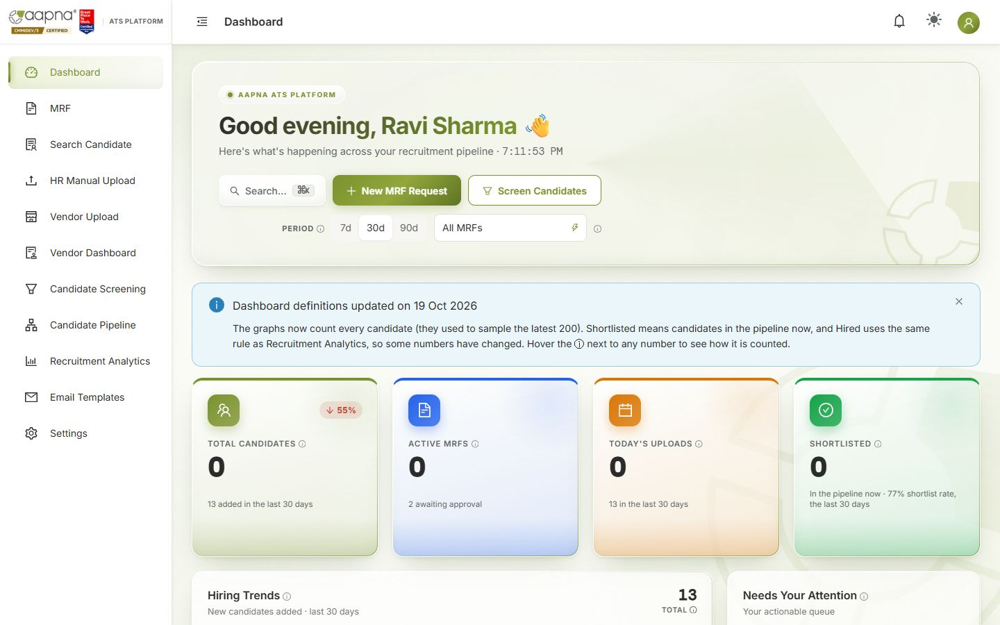

- **Period** (7d / 30d / 90d) and **All MRFs** change every number on the page to that period or that position.
- **Total candidates**: everyone added in the period. **Active MRFs**: open positions (with how many await approval). **Today's uploads**: resumes added since midnight India time. **Shortlisted**: candidates in the pipeline right now, with the shortlist rate for the period.
- **Hiring trends**, the **funnel** and **talent insights** count every candidate in the period.
- **Upcoming interviews** lists Zeko windows and Teams interviews; click one to open the candidate. **Recent uploads**: click a row to open the candidate.
- **Needs your attention** collects actions waiting on you.
- **New MRF Request** and **Screen Candidates** are shortcuts.

## 3. MRF: hiring requests
An MRF (Manpower Requisition Form) is a request to hire. Candidates can only be screened against an MRF once it is approved.

**How an MRF moves**

| Step | Who | What happens | Status you see |
|---|---|---|---|
| 1. Request | Recruiter, on the MRF screen | You fill the short **New MRF Request** form; the hiring manager is emailed a link | **Pending** |
| 2. Details | Hiring manager, from the email | They fill in the full requisition: role, openings, skills, experience, qualification, budget, JD | **Manager submitted** |
| 3. Approval | Approvers, from their own email links | Each approver gets a personal link. **One approval is enough.** The others are told it is decided | **Approved** / **Rejected** |
| 4. Hiring | Recruiters | The role appears in Candidate Screening's JD tab | Approved |
| 5. Closing | Automatic, or a recruiter | It closes when all openings are filled by accepted offers, or you close it by hand with a reason | **Closed** |

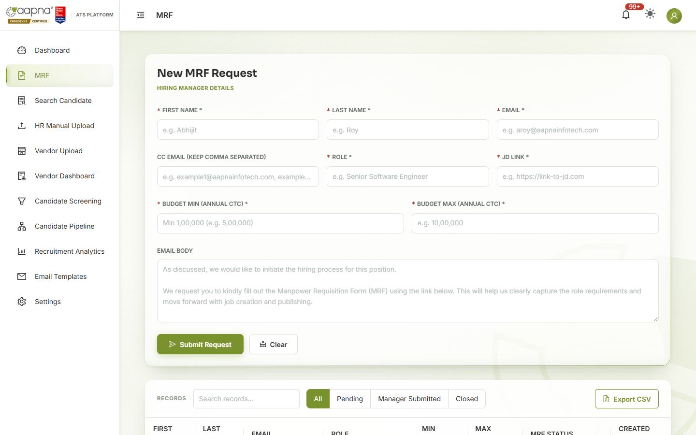

**Raise a request**
1. Open **MRF**. Fill **Hiring manager details**: first name, last name, email (and CC emails, comma-separated), **Role**, **JD link**, **Budget min / max (annual CTC)**, and an optional **Email body** message.
2. Click **Submit Request**. The hiring manager receives the form link.

**Follow a request**
- **Records** lists every MRF. Filter with **All / Pending / Manager Submitted / Closed**. **Export CSV** downloads the list.
- Click a row for the details: the workflow summary, the **Approval trail** (who was asked, who opened the link, who decided and when, and the comment), the JD and every field the manager submitted.

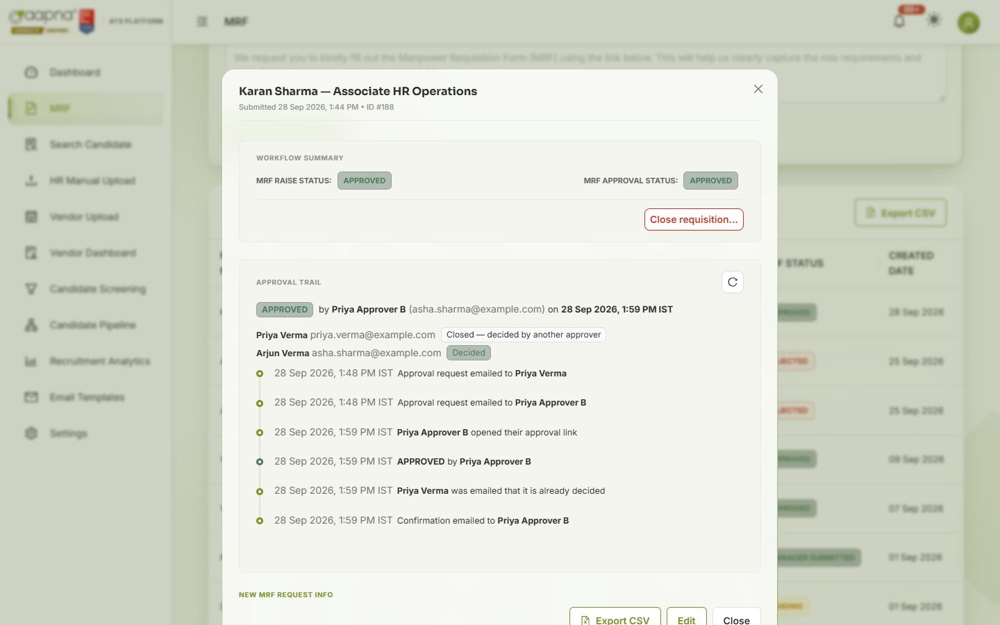

- **Close requisition…** (in the details) closes a position by hand. Pick a reason (filled elsewhere, cancelled, on hold…). A closed MRF can be reopened.
- If an approver lost their email or the link expired, **Re-send approval links** (under the approval trail) sends everyone a fresh personal link; the old ones stop working.

## 4. Getting resumes in: HR Manual Upload
Resumes reach the ATS in three ways: you upload them here, vendors upload them, or candidates email them to the recruitment mailbox (picked up automatically). All three are read by AI, checked for duplicates and saved to the candidate database.

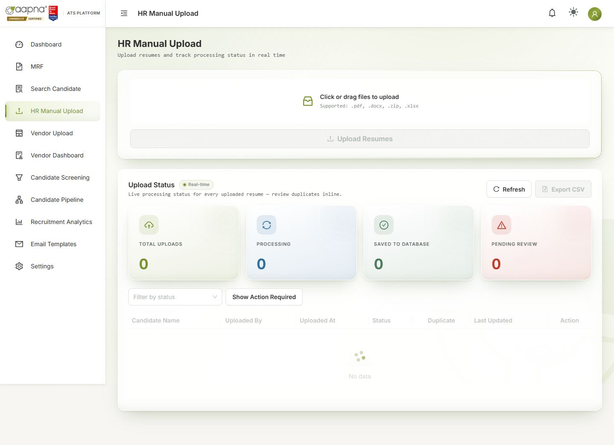

**Upload**
1. Open **HR Manual Upload**. Drag files onto the box, or click it. Accepted: **.pdf, .docx, .zip** (a folder of resumes) and **.xlsx** (an Excel list of candidates).
2. Click **Upload Resumes**. Processing runs in the background; you can leave the page.

**Watch progress.** **Upload Status** updates in real time. Tiles: **Total uploads**, **Processing**, **Saved to database**, **Pending review**.

| Status | Meaning | What to do |
|---|---|---|
| Processing | Being read | Wait |
| Saved to Database | New candidate added | Nothing |
| Awaiting Candidate Details | Saved, and the candidate was emailed a form for missing details (e.g. experience, CTC, notice) | Nothing; they fill it in. You'll see it in **Search Candidate → Details completed** |
| Pending Recruiter Review / Duplicate = Yes | This person may already exist | Click **Review** (below) |
| Rejected by System | No email or phone found in the resume | Get a resume with contact details |
| Processing Failed | Something went wrong reading the file | Try **Reprocess**. If it fails again, report it with the ref (§13) |

**Duplicates.** Tick **Show Action Required** to see only rows waiting for you. **Review** shows the new resume beside the existing record: who uploaded each, when, and from where. Choose **Merge** (update the existing person with the new details) or **Reject / Cancel** (keep the existing record as it is). **View full details** shows everything first.

## 5. Uploading for a vendor
**Vendor Upload** is the same screen for resumes that came from a placement vendor.

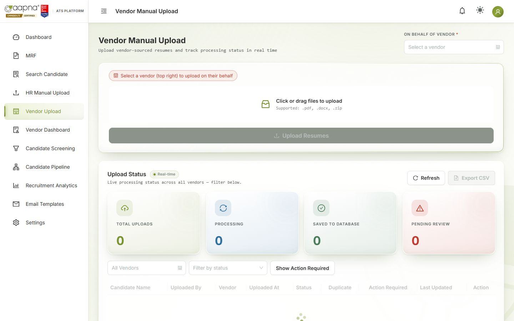

1. Choose the vendor in **On behalf of vendor**. Then drag the files in and click **Upload Resumes**.
2. The candidate is recorded against that vendor. The vendor is told about status changes by email (status only, never CTC or documents) and sees them on their dashboard.
3. A candidate submitted by a vendor is **owned by that vendor for 90 days**. If another vendor sends the same person in that time, the upload waits for your review.

**Vendor Dashboard** (menu) shows what each vendor has submitted and where their candidates are.

## 6. Search Candidate
The full candidate database: look someone up, check their details, edit them.

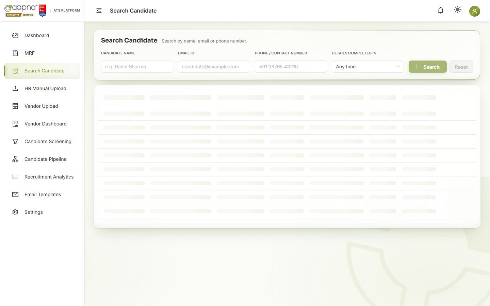

- Search by **Candidate name**, **Email ID** or **Phone**, or browse the whole list. **Details completed in** shows people who finished their missing-details form in a period.
- Columns include **Date added**, **Details requested** and **Details completed**, so you can see who still has to fill in their form.
- **Export CSV** downloads the list.
- Click a candidate to open their full record: profile, resume link, emails exchanged, scores from the pipeline, and their journeys. **Edit** changes their details. The change reaches the pipeline too, and their old email is kept so replies still match.
- Tick candidates and click **Add to JD** to shortlist them for an open MRF (the same dialog as in Candidate Screening).
- Mark a referral here (see §12).

## 7. Candidate Screening
Where you find the right people for a role and shortlist them. Two tabs:
- **JD Filtering**: pick an approved MRF; the ATS shows the candidates who meet **all** its requirements, best first.
- **Keyword Filtering**: search the whole database with your own skills and filters.

The full rules for who appears and in what order are in **[Candidate Screening: how candidates are found and ranked](../Screening-Rules-for-RT.md)**. The essentials:
1. **Filters decide who appears; the score only decides the order.**
2. **Every filter is strict, and a blank counts as "does not meet it."** The most common reason someone is missing: the field you filtered on is empty on their profile. Fill it in and they appear.
3. Skills match **whole words** with common spellings (Java ≠ JavaScript; .NET = dotnet), in the skills list, the resume keywords or the resume text.
4. Candidates **rejected in the last 90 days** are left out (searching by name, email or phone still finds them).

### Keyword Filtering

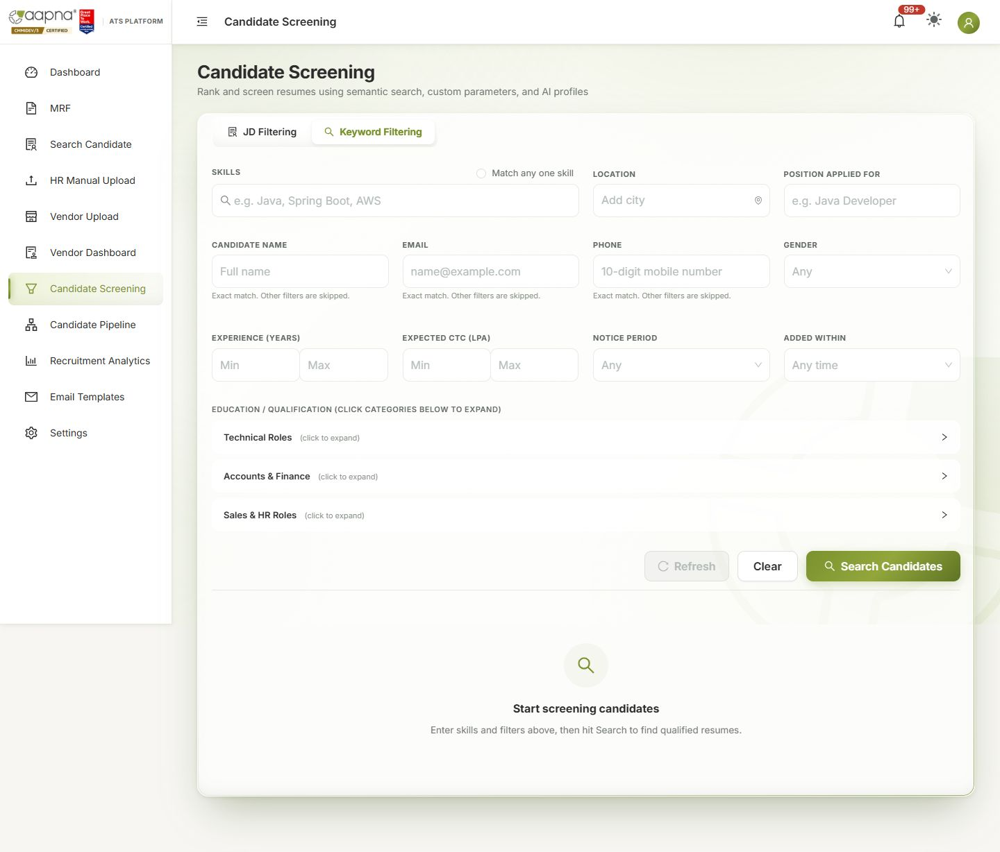

1. Type **Skills** (comma-separated). All of them must match, or tick **Match any one skill**.
2. Add any of: **Location** (each city must match exactly; add several to accept any), **Position applied for**, **Gender**, **Experience (years)**, **Expected CTC (LPA)**, **Notice period**, **Added within** (last 7, 10 or 15 days, 1 month, 3 months), **Education / Qualification** (open a category and tick degrees).
3. Click **Search Candidates**.
4. To look up one person, use **Candidate name**, **Email** or **Phone** instead. Other filters are then skipped.

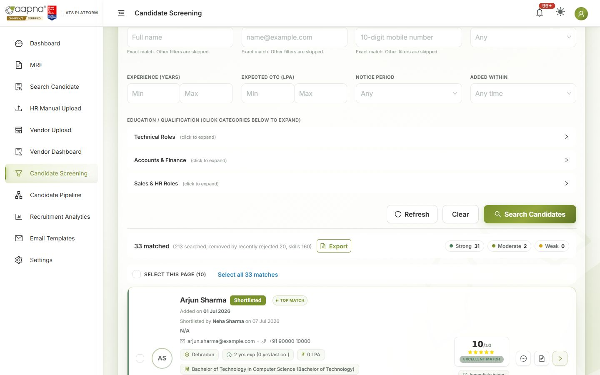

The summary line shows how many matched and **how many each filter removed**, so you can see which filter is narrowing the search. The chips count **Strong / Moderate / Weak** matches. **Export** downloads the results.

### JD Filtering

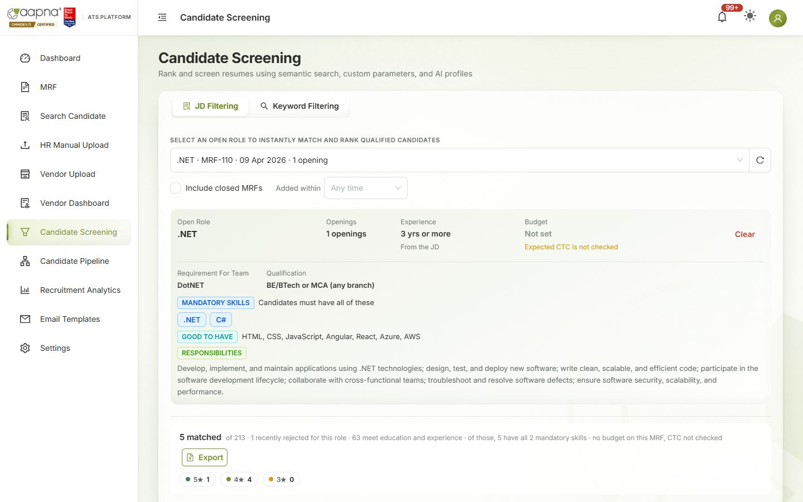

1. Choose a role in **Select an open role** (tick **Include closed MRFs** to see older ones). **Added within** limits it to recent candidates.
2. The **role card** shows exactly what is checked: **mandatory skills (all required)**, **experience** range, **budget** (expected CTC must be at or under it; "Not set" means CTC isn't checked) and **qualification**. If the card shows something the JD didn't mean, correct the MRF.
3. Results are ranked out of 10 (stars). The summary line explains how many met each check.
4. The **AI summary**, fit verdict, red flags and skill gaps (top 10 candidates) help you read a profile; the AI never decides who is shown.

### Shortlist or reject
- Open a candidate card to see the full profile, resume and AI summary.
- **Shortlist** a candidate (or several, with **Select this page**) for the role. A preview of the email they will receive opens first; you can edit it before sending. Shortlisting starts their **journey** on the Candidate Pipeline.
- **Reject** asks for a reason. Rejected candidates are left out of searches for 90 days.
- From **Search Candidate** you can do the same for people you already know: tick them in the list → **Add to JD** → choose the MRF. It opens the same shortlist dialog.

## 8. Candidate Pipeline
Every shortlisted candidate, by stage. One card = one candidate's journey for one MRF.

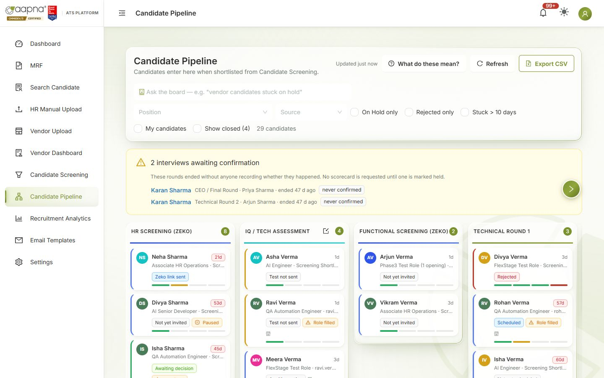

### Reading the board
- **Columns** are the stages: HR Screening (Zeko) → IQ / Tech Assessment → Functional Screening (Zeko) → Technical Round 1, 2, 3 → HR Round → CEO / Final Round → Client Interview → Documents → Offer. Hover over a column title to see what it means.
- **A card** shows the name, days in this stage (e.g. "21d"), position, source (screening shortlist, vendor, referral…), who owns it, and a **label** for where the candidate is (e.g. *Zeko link sent*, *Test overdue*, *Awaiting decision*). The small bar shows the stage's steps; hover over it for details.
- **What do these mean?** explains every label and stage:

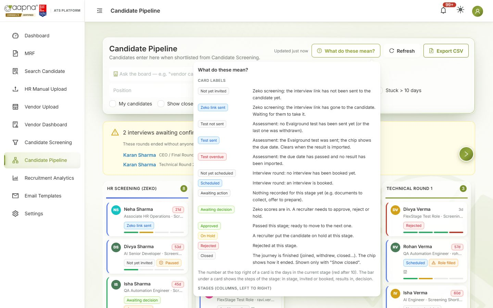

- **Filters:** Position, Source, **On Hold only**, **Rejected only**, **Stuck > 10 days**, **My candidates**, **Show closed**. **Export CSV** downloads the board.
- **Interviews awaiting confirmation** (yellow box) lists rounds that ended without anyone recording whether they happened. No scorecard is requested until someone marks it held.
- Other badges: **Paused** (the journey is paused), **Role filled** (the MRF's openings are filled).

### The candidate drawer
Click a card to open it.

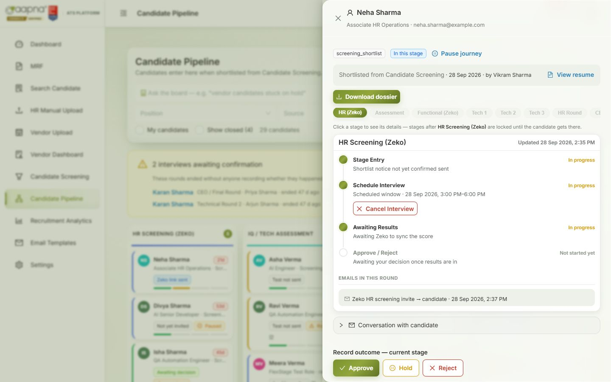

- **Top:** name, position, email; **View resume**; **Download dossier**; **Pause journey**; when and by whom they were shortlisted.
- **Stage tabs** (HR Zeko, Assessment, Functional, Tech 1…Offer). Stages ahead of the candidate are locked until they get there.
- Each stage shows its **steps** with status, the **emails sent in this round**, and actions.
- **Conversation with candidate**: every email to and from the candidate; reply from here.
- **Record outcome — current stage**: **Approve**, **Hold**, **Reject**.
- **Close this candidate's record**: for an exit that is not a stage decision: withdrew, backed out, joined, did not join.

### Recording an outcome (every stage)
1. Click **Approve**, **Hold** or **Reject**.
2. **Hold** and **Reject** need a **reason** (pick from the list, add text if you like).
3. **Send email notification to candidate** is ticked by default. Untick it if you don't want the outcome email to go (for example, you told them by phone).
4. Confirm. **Approve** moves the candidate to the next stage. Every decision is recorded with your name and time. If the candidate came from a vendor, the vendor gets a status-only email.

**Optional rounds** (Technical Round 3, CEO, Client) can be skipped: **Skip this optional round**. **Move to…** sends a candidate to another stage when your process needs it.

### Zeko rounds (HR Screening, Functional Screening)
1. In the stage, click **Schedule Interview**. Choose the **Zeko job** and the **interview window** (opens / closes, India time), then confirm. The candidate gets the Zeko link by email. Card: *Zeko link sent*.
2. When the candidate finishes, the score arrives within a few minutes. Card: *Awaiting decision*. Open the stage to see the score and **View full report on Zeko**.
3. Record the outcome. **Cancel Interview** (with an optional reason) withdraws the link.

### IQ / Tech Assessment (Evalground)
1. **Send Evalground Invite**: record the test sent and its due date. Card: *Test sent · due (date)*; after the due date, *Test overdue* in red. **Mark as sent manually** if you sent it outside the ATS; **Withdraw invite** cancels it, optionally emailing the candidate.
2. When results come, **import the Evalground CSV**: *IQ / Tech Assessment — import Evalground results*. The ATS matches each row to the candidate by any of their emails and shows Matched / Unmatched / Malformed rows before you save. Scores appear on the candidate; if an admin turned on auto-advance, the pass mark decides the outcome automatically.

### Interview rounds (Technical 1–3, HR Round, CEO / Final)
1. **Schedule Interview**: check the **interviewee** details, enter the **interviewer** name and **email(s)**, the date, time and **duration**. Book it.
2. The ATS creates the Outlook invite with a Teams link, emails the candidate and the panel, and sends reminders before the interview (Settings → Interview Reminders).
3. After the interview, it checks whether it happened (Teams attendance where available). Otherwise the interviewer, or you, is asked. **Mark as Held** or **Mark No-show** (who didn't join: candidate, interviewer / panel, neither side, or a technical failure). **Reschedule** or **Cancel Interview** at any time before.
4. Once marked held, the interviewer is emailed their **scorecard** link. Their scores appear in the stage; **Scorecard report** combines every round. A scorecard link expires after 7 days.
5. Where recording is on, the **Interview recording** appears in the stage once Teams finishes processing it. You can watch it and create a time-limited **share link** for someone outside (revoke it any time).
6. Record the outcome.

### Client Interview
Arranged by you outside the ATS. Mark it as held and **Record client feedback**, then record the outcome.

### Documents
1. **Request documents**: the candidate receives a secure link to upload them (no login needed). Up to 3 reminders go automatically, one a day from the second day (**Send a reminder now** chases straight away).
2. For each upload: **Verify**, or **Reject & re-request** with a reason (the candidate is asked for just that document again). **Cancel the request** if no longer needed.
3. Document emails never go to vendors.

### Offer
1. **Request internal approval**, then **Mark approved** when it is approved.
2. **Record offer shared** when the offer letter has gone to the candidate (the letter itself is sent outside the ATS).
3. Record the answer: **Mark accepted** or **Mark rejected**. An accepted offer counts towards the MRF's openings; when all openings are filled, the MRF closes by itself.

### Closing a candidate's record
**Close this candidate's record** → choose how it ended: **Joined**, **Did Not Join**, **Candidate Withdrawn**, **Backed Out**, **Joined and Left**, and the other final statuses. Closed journeys leave the board (tick **Show closed** to see them); **Reopen record** brings one back. Joined records close themselves 90 days after the joining date.

### Candidate dossier
**Download dossier** builds one pack for an external interviewer: resume, Zeko and Evalground reports, scorecards and recording links. It never contains CTC, vendor or referral information. Ask the recipient to delete it after 30 days, as the pack says.

## 9. Recruitment Analytics
Read-only reports. Nothing here changes a candidate or sends an email. Full definitions: **[Recruitment Analytics guide](../Recruitment-Analytics-User-Guide.md)**.

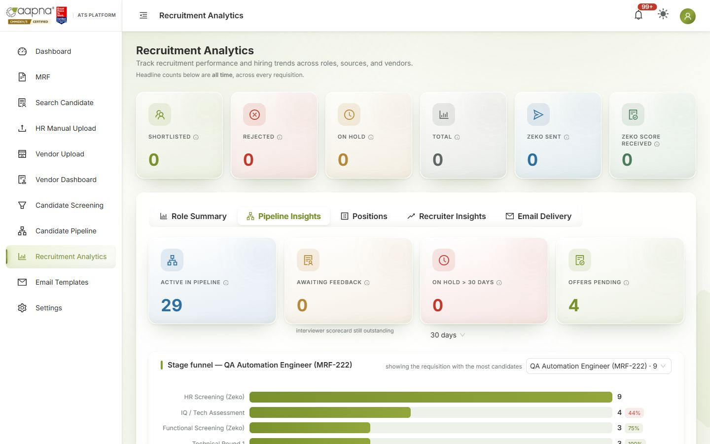

| Tab | Answers |
|---|---|
| **Role Summary** | Per role: shortlisted, rejected, on hold, future prospect, closed, total |
| **Pipeline Insights** | Active in pipeline, awaiting feedback, long holds, offers pending; the **stage funnel** for one MRF (conversion from each stage to the next); stuck candidates |
| **Positions** | One row per MRF: opened, days open, openings, shortlisted, moved forward, how many reached each stage, offers, accepted, joined, **joining ratio**, closure reason. Click a row to see its funnel. **Open / Closed / All**, **Export** |
| **Recruiter Insights** | Activity per recruiter |
| **Email Delivery** | Emails sent, opened, bounced |

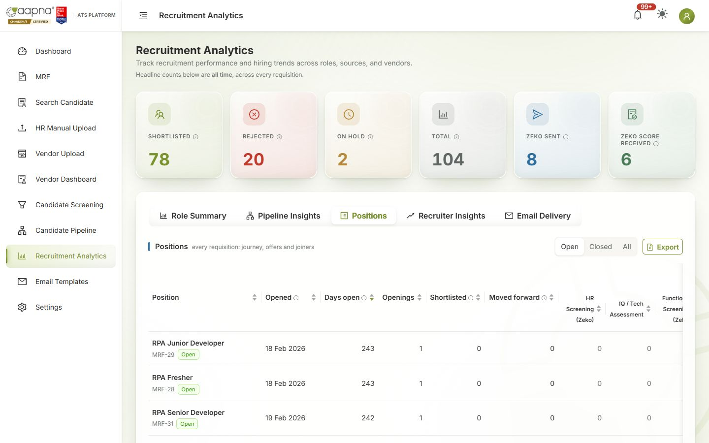

The six numbers at the top are **all-time totals** across every MRF.

## 10. Forms & Links: finding a link you sent
Every link the ATS has emailed, in one list: interviewer scorecards, Teams meetings, recording links, document uploads, complete-profile forms, Zeko interviews, Evalground tests, MRF request forms and MRF approvals. Use it when someone says "I never got the link", or when you want to paste a link into WhatsApp or Teams.

- **Find it:** type a candidate, interviewer, approver, email, role or MRF number in the search box. Search looks at every link, however old. Or press **Ctrl+K** anywhere, type a name, and pick **Find a link for "…"**.
- **The four tiles** at the top (waiting, expiring within 48 h, expired before a response, not delivered) filter the list. Click one again to clear it.
- **Tabs** split the list by who the link went to. **Standing forms** holds the links that are the same for everyone: the blank MRF form, sign-in, forgot password, and the JD and test paper of every open MRF.
- By default the list shows links that are **open or expired**. Use the status buttons for done or closed ones, **Sent** for a date range, and **My candidates** for the journeys you shortlisted.
- **Complete-profile forms** are hidden while you browse, because the ATS sends one to every upload with missing details. Search for the candidate, or switch on the chip, to see theirs.

**What you can do with a link**
- **Copy link**, or **Copy with message** (the arrow beside it) for a ready-to-paste note: who it is for, the round, the deadline. Each copy is noted on the candidate's timeline, so the team can see who shared what.
- **Re-send** emails the same link again. **Renew & re-send** brings an expired scorecard back for 7 days. **Revoke** stops a recording link at once. The ATS asks before anything is emailed.
- **MRF approval links are never copied.** Whoever opens one decides in the approver's name. Use **Re-send approval links** instead: each approver gets a new personal link, and the old ones stop working.
- Scorecard and recording links can be copied but not opened from here, because opening one would count as the interviewer opening it.

**Shortcuts:** the **Still awaiting feedback** card in the candidate's scorecard report has Copy, Re-send and Renew for each round, plus **All links for this candidate**. The MRF details window shows the hiring manager's form link. The Dashboard's **Needs your attention** shows how many links are waiting for a response.

If you cannot see scorecards, meetings or documents here, you do not have the Candidate Pipeline. Ask your admin to switch it on.

## 11. Email Templates
The text of every email the ATS sends: shortlist, outcome emails, interview invites and reminders, document requests, and more.

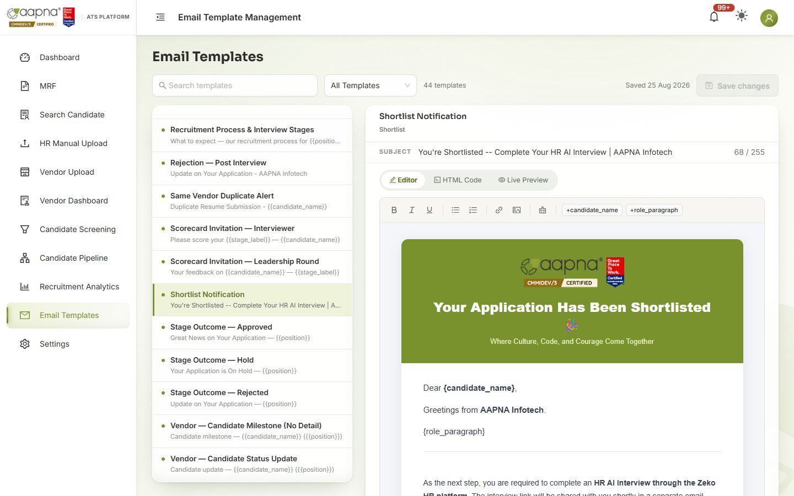

1. Pick a template on the left (search, or filter **All Templates** by type).
2. Edit the **subject** and the body in **Editor** (or **HTML Code**). Words in braces, like `{candidate_name}` or `{{position}}`, are filled in automatically: keep them exactly as they are. The buttons above the body (e.g. **+candidate_name**) insert them for you.
3. **Live Preview** shows the email as the candidate will see it. **Save changes**.

Only admins can create new templates. To see which emails were sent and opened, use **Recruitment Analytics → Email Delivery**.

## 12. Settings

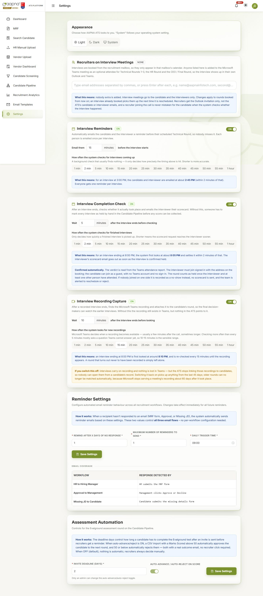

| Section | What it controls |
|---|---|
| **Appearance** | Light, Dark or System theme (just for you) |
| **Recruiters on Interview Meetings** | Extra people added to every Teams interview the ATS books (so recruiters see them in their calendar) |
| **Interview Reminders** | On/off; how many minutes before the interview the candidate and interviewer are reminded |
| **Interview Completion Check** | On/off; how long after an interview the ATS checks whether it happened and sends the scorecard |
| **Interview Recording Capture** | On/off; how soon recordings are looked for |
| **Reminder Settings** | How often, and how many times, candidates are reminded to complete their details |
| **Assessment Automation** | Default test due period; auto-advance / auto-reject on the Evalground score (admin only) |

Changes apply to everyone. Each section explains in plain words what its setting will do before you save.

## 13. Referral candidates
When an AAPNA employee refers someone, record it so that it counts at the final decision, while interviewers never see it.

1. **Search Candidate** → open the person → **Edit** → **Referral** section.
2. Tick **This candidate was referred by an employee**, type **who referred them** (pick the existing spelling if offered), add a note if useful, **Save referral**.
3. A green **Referral** chip then shows on Search Candidate, Candidate Screening, the pipeline board and drawer. Interviewers, vendors, scorecards and dossiers never show it.

**Two rules:** never write the referral on the resume file itself (it travels in the dossier), and don't use the "Job Source" field for it. Only an admin can remove a referral, with a reason. Full guide: [docs/reference/REFERRAL_CANDIDATE_RECRUITER_GUIDE.md](../reference/REFERRAL_CANDIDATE_RECRUITER_GUIDE.md).

## 14. When something goes wrong
- **"Something went wrong… (ref: K7Q2MX)"**: copy the whole message, including the ref, and send it to the ATS team with what you were doing. The ref lets them see exactly what happened; you don't need a screenshot.
- **A message without a ref** (e.g. "Email is required") is telling you what to fix on the form.
- **A candidate you expected is missing from screening:** see the checklist at the end of [the screening rules](../Screening-Rules-for-RT.md).
- **A number looks wrong on Analytics:** the fix is usually on the screen where the data was entered (the candidate's stage or status).
