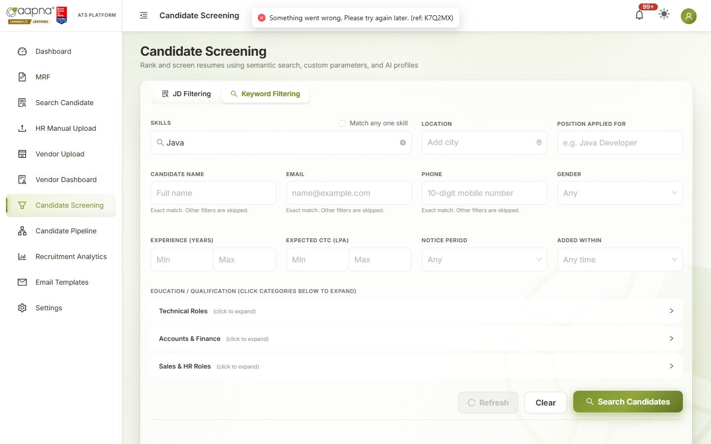

# AAPNA ATS: user guides

Step-by-step guides for the people who use the ATS every day. No technical knowledge needed.

| Guide | For |
|---|---|
| [Recruiter & HR guide](01-RECRUITER-HR-GUIDE.md) | The recruitment team: MRFs, uploads, searching, screening, the candidate pipeline, interviews, tests, documents, offers, analytics |
| [Admin guide](02-ADMIN-GUIDE.md) | Company admins: users, access, settings, templates, the pipeline set-up |
| [Super Admin guide](03-SUPERADMIN-GUIDE.md) | Super Admins: companies, users across companies, Logs & errors, system health |
| [Vendor guide](04-VENDOR-GUIDE.md) | Placement vendors: uploading candidates and following their progress |
| [For people who only receive emails](05-EMAIL-ONLY-USERS.md) | Hiring managers, MRF approvers, interviewers |

**Companion documents** (full detail on two topics the recruiter guide summarises):
- [Candidate Screening: how candidates are found and ranked](../Screening-Rules-for-RT.md)
- [Recruitment Analytics: what every number means](../Recruitment-Analytics-User-Guide.md)

---

## Who can do what

The ATS has four kinds of account. Your administrator decides which one you have, and can switch individual screens on or off for you.

| Account | Can |
|---|---|
| **Super Admin** | Everything, across every company: companies, all users, Logs & errors |
| **Admin** | Everything in their own company: add and manage recruiters and vendors, choose which screens each person sees, change settings and email templates, remove referrals, read the referral log |
| **Recruiter (HR)** | The recruitment screens they have been given: MRF, Search Candidate, uploads, Candidate Screening, Candidate Pipeline, Analytics, Email Templates, Settings |
| **Vendor** | Upload candidates and follow the candidates they submitted. Nothing else |

Some people never sign in: **hiring managers** raise and receive MRF updates, **approvers** approve MRFs, **interviewers** get invites and fill in a scorecard, and **candidates** fill in forms and upload documents. They all work from links in their emails; see [the email-only guide](05-EMAIL-ONLY-USERS.md).

Everyone can change their own password: click your picture (top right) → **Change Password**, or use **Forgot password?** on the sign-in page.

---

## Words used in the ATS

| Word | Meaning |
|---|---|
| **MRF** | Manpower Requisition Form: a request to hire for a position. It must be approved before candidates can be screened for it |
| **JD** | Job description, attached to the MRF |
| **Shortlist** | Choosing a candidate for an MRF. It starts their **journey** in the Candidate Pipeline |
| **Journey** | One candidate's progress for one MRF. A candidate can be on two journeys for two MRFs |
| **Stage** | A step of the journey (the columns of the pipeline board) |
| **Outcome** | What you decide at a stage: **Approve** (move on), **Hold**, or **Reject**. Every Hold and Reject needs a reason |
| **Zeko** | The AI video interview platform used for HR Screening and Functional Screening |
| **Evalground** | The online test platform used for the IQ / Tech Assessment |
| **Scorecard** | The interviewer's feedback form, sent by link after the interview |
| **Dossier** | A downloadable pack about one candidate, for an external interviewer |
| **Ref** | A short code on an error message, e.g. "ref: K7Q2MX". Send it to the ATS team when you report a problem |

### Pipeline stages, in order

| Stage | What happens |
|---|---|
| Shortlist | Candidate shortlisted for the role |
| HR Screening (Zeko) | AI HR screening interview on Zeko. Send the link, then decide on the scores |
| IQ / Tech Assessment | Online test on Evalground. Send the test, then import the results |
| Functional Screening (Zeko) | AI functional (skills) interview on Zeko |
| Technical Round 1, 2 | Technical interviews with the panel, booked on Teams |
| Technical Round 3 | Optional third technical interview |
| HR Round | HR discussion: expectations, notice period, fit |
| CEO / Final Round | Optional final round with the CEO / management |
| Client Interview | Optional client interview, arranged outside the app |
| Documents | Collect and verify the candidate's documents |
| Offer | Prepare, approve and share the offer; record the candidate's decision |

Admins can rename, reorder or add stages, so your board may differ slightly.

### Labels on pipeline cards

| Label | Meaning |
|---|---|
| Not yet invited | Zeko screening: the interview link has not been sent yet |
| Zeko link sent | The Zeko link has gone to the candidate; waiting for them to take it |
| Awaiting decision | Zeko scores are in. A recruiter needs to approve, reject or hold |
| Test not sent | No Evalground test has been sent yet (or the last one was withdrawn) |
| Test sent · due (date) | The test was sent; clears when the result is imported |
| Test overdue (red) | The due date has passed and no result has been imported |
| Not yet scheduled | Interview round: no interview booked yet |
| Scheduled | Interview round: an interview is booked |
| Awaiting action | Nothing recorded for this stage yet (documents to collect, offer to prepare) |
| Approved / On Hold / Rejected | The decision recorded at this stage |
| Closed | The journey is finished (joined, withdrew…). Shown only with **Show closed** |

The board's **What do these mean?** button shows the same list.

---

## When something goes wrong
If you see **"Something went wrong… (ref: K7Q2MX)"**, copy the message, including the ref, and send it to the ATS team with what you were doing. The ref lets them find exactly what happened. You don't need a screenshot.

---

## About these guides
- They describe the ATS as released at the end of the Phase 3 feedback work (October 2026). Screens change with each release, and the guides are updated with them.
- The screenshots use **sample people**: names, emails and phone numbers are replaced before the picture is taken.
- To share a guide outside the ATS team, use the PDF copy exported from these pages.
